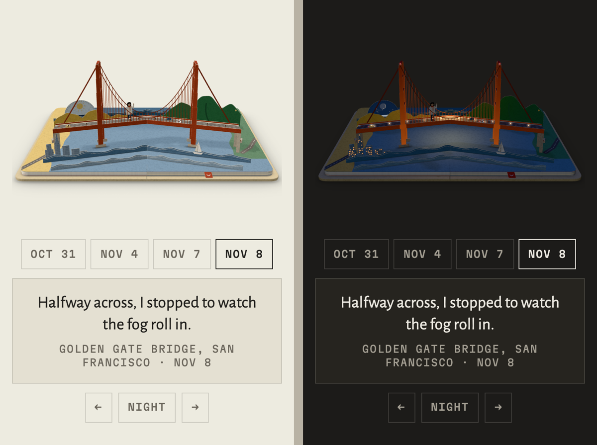

# Popbook

Send a photo or a line. Get a pop-up book page.

Popbook is a skill for AI agents. You send your agent a photo from your day (or one line about it), and it builds a page of a paper pop-up book you can play with: layers of cut paper stand up from the gutter, a pull-tab slides, a door swings open, a sun-and-moon dial turns day into night, and something in the scene keeps moving on its own. You get one HTML file. Open it, send it, host it anywhere. No server, no install, no network.

I built it for my own site, where the book holds one moment from my week. This is the same engine, packaged for you.



## Install

Popbook is an [Agent Skill](https://docs.claude.com/en/docs/agents-and-tools/agent-skills/overview): a folder with a `SKILL.md`.

- **Claude Code:** paste this in Terminal:

  ```
  npx degit jiaosdesign-pixel/popbook/popbook ~/.claude/skills/popbook
  ```

  Or, from a clone of this repo: `cp -R popbook ~/.claude/skills/` (it becomes `~/.claude/skills/popbook/`).
- **Claude app:** download [popbook.zip](https://jiao-design.vercel.app/playground/popbook/popbook.zip) (or zip the `popbook/` folder yourself) and add it under Settings, Capabilities, Skills.
- **Other agents:** point yours at `popbook/SKILL.md`.

You need Node 18 or newer. Python 3 with Pillow reads photos and makes the preview card. Playwright, if you have it, lets the agent check its own work in a headless browser.

## Use

Send a photo and a line:

> Morning swim before work. Steam coming off the pool. Nov 6.

Your agent reads the photo, picks pieces from the kit, folds them into a spread, checks it by day and by night, and hands you `book.html` with two caption options. Send another photo next week and it becomes the next page.

## What's inside

| Path | What |
|---|---|
| `popbook/SKILL.md` | the instructions your agent follows |
| `popbook/references/kit.md` | every paper piece, its parameters, and the fold-flat rules |
| `popbook/examples/` | four scenes from my book, with my words and dates taken out, as worked examples |
| `popbook/scripts/` | `new.mjs` starts a page, `build.mjs` makes the one HTML file, `check.mjs` tests it in a headless browser, `photo.py` reads a photo's date and colours |
| `popbook/book/` | the pop-up engine (three.js) |
| `popbook/vendor/`, `popbook/fonts/` | three.js and the two typefaces, with their licences |

## Credits

Made by [Jiao Shi](https://www.linkedin.com/in/jiaoshi/). Every book drawn by Claude with Claude Code. More on the [Popbook page](https://jiao-design.vercel.app/playground/popbook/).
Built on [three.js](https://threejs.org) (MIT). Type: Alegreya Sans by Huerta Tipográfica and Martian Mono by Evil Martians, both SIL Open Font License 1.1.

## License

MIT for the code and the examples. The fonts keep their own licence (`popbook/fonts/OFL-*.txt`), and three.js keeps its own (`popbook/vendor/three/LICENSE`).
